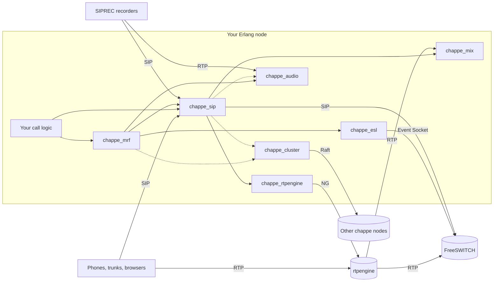

# chappe

chappe is an open source platform for building voice services in Erlang/OTP.
Signalling runs in your Erlang node: a SIP stack with UAS, UAC, B2BUA, proxy
and registrar. Media runs in engines that chappe drives: rtpengine for
relaying, recording and transcoding, chappe_mix for conferences, and
FreeSWITCH for IVR. It is for developers who write SBCs, PBXs, IVRs and AI
voice front ends, and want the call logic as plain Erlang processes.

Named after Claude Chappe, who built the first practical telecommunications
network (the optical semaphore telegraph, 1794).

## The apps

| App | Role | Depends on | Start reading at |
|---|---|---|---|
| chappe_sip | The SIP stack: sofia-sip's transaction layer in a C NIF, everything above it in Erlang. WebSocket, TLS, SIPREC, the media facade `chappe_sip_media`. | chappe_rtpengine, chappe_mix (on demand), chappe_audio (optional, SIPREC), chappe_cluster (started when `cluster => chappe_cluster`) | [README](apps/chappe_sip/README.md), [getting started](apps/chappe_sip/docs/guides/getting-started.md) |
| chappe_rtpengine | A client for rtpengine's NG control protocol: anchoring, recording, playback, forks. Leaf, SIP-free. | none | [README](apps/chappe_rtpengine/README.md) |
| chappe_mix | An RTP audio conference mixer: G.711, N-1 mix, one process per room. Leaf, SIP-free. | none | [README](apps/chappe_mix/README.md) |
| chappe_esl | A FreeSWITCH Event Socket client: inbound and outbound, a node registry, typed call control. Leaf, SIP-free. | none | [README](apps/chappe_esl/README.md) |
| chappe_audio | Takes a call's audio in and keeps it: a WebSocket sink for audio forks, SIPREC audio, the recording store. Leaf, SIP-free. | none | [README](apps/chappe_audio/README.md) |
| chappe_cluster | One owner per key across a region's nodes, on Ra (Raft): fenced leases, a small KV, singletons. Leaf, SIP-free. | none | [README](apps/chappe_cluster/README.md) |
| chappe_mrf | A media resource function: IVR endpoints on FreeSWITCH, bridging, conferences on chappe_mix or FreeSWITCH. Orchestration. | chappe_sip, chappe_esl, chappe_audio, chappe_cluster (optional) | [README](apps/chappe_mrf/README.md) |

Products (an SBC, an AI voice product, a PBX) live in their own repositories
and depend on these packages. Each app is published to hex on its own.

## The system



RTP never flows through a SIP process: SIPREC audio is taken in by
chappe_audio ([0012](docs/decisions/0012-siprec-srs.md)). Dotted arrows are
optional. See [Architecture](docs/architecture.md) for the flows.

## Four ways in

### Run the demo

A small SBC with a registrar, a WebRTC page, calls between two users, and an
IVR on FreeSWITCH. Needs docker.

```sh
make demo
```

Then follow [demo/sbc/README.md](demo/sbc/README.md).

### Build your first service

Requires Erlang/OTP 29.1.2 or later (earlier releases have TLS flaws (CVE-2026-89422, a TLS 1.3 server impersonation, and CVE-2026-105236, an SNI resumption bypass)), rebar3, a C toolchain, autotools
and OpenSSL. The first compile builds the vendored sofia-sip.

```sh
make
rebar3 shell
```

```erlang
ok = chappe_sip:start(#{contact => <<"sip:127.0.0.1:5060">>}),
ok = chappe_sip:invite(fun(Req, Res) ->
    {ok, Legs} = chappe_sip:create_b2bua(Req, Res, <<"sip:bob@127.0.0.1:5080">>, #{}),
    chappe_sip_b2b:relay(Legs)
end).
```

Then read [Getting started](apps/chappe_sip/docs/guides/getting-started.md).

### Run several nodes

Three chappe nodes on chappe_cluster in docker: one registrar, one
conference room and one trunk pinger across them. Needs docker.

```sh
make demo-cluster
```

Then follow [demo/cluster/README.md](demo/cluster/README.md).

### Understand the code

Read [Concepts](docs/concepts.md), then [Architecture](docs/architecture.md),
then [Navigation](docs/navigation.md). The [documentation map](docs/README.md)
lists every page by reader and by question.

## Checks

```sh
make check        # compile, eunit, ct, lint, xref, dialyzer, fmt check
make asan         # the C NIF under AddressSanitizer (Linux container)
make tsan         # the NIF lifecycle suites under ThreadSanitizer
make lint-c       # clang-tidy and gcc -fanalyzer on the C shim
make fuzz         # the libFuzzer targets and the NIF boundary fuzz suite
make cover        # eunit + ct line coverage (MIN_COVERAGE=N to gate)
make compliance   # per-app RFC requirement matrices (GATE=demo to gate)
make advisories-test  # unit tests of the advisories checker
make demo-compile # compile and xref the demo sources
make docs         # ex_doc HTML for every app that configures it
```

The interop labs run against real rtpengine, FreeSWITCH, Kamailio and SIPp
in docker: `make interop`, `interop-conformance`, `interop-sbc`,
`interop-mix`, `interop-esl`, `interop-mrf`, `interop-cluster`, and
`demo-esl`; see [the labs](docs/contributing/labs.md). How to get a change in:
[CONTRIBUTING.md](CONTRIBUTING.md).

## Links

- [Documentation map](docs/README.md)
- [CHANGELOG](CHANGELOG.md)
- [CONTRIBUTING](CONTRIBUTING.md)
- [Decisions](docs/decisions/README.md)

## License

Apache-2.0 (see [LICENSE](LICENSE)). Bundles sofia-sip under LGPL-2.1 (see
[NOTICE](NOTICE)).
