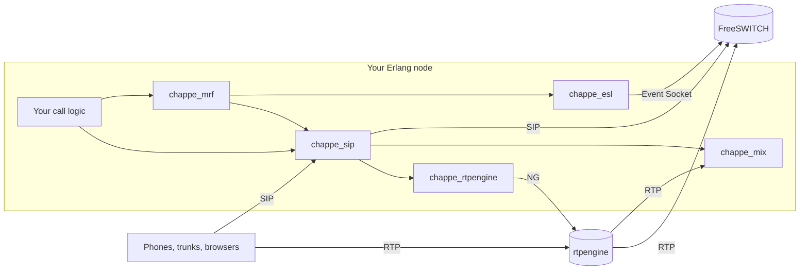

# chappe

chappe is an open source platform for building voice services in Erlang/OTP.
Signalling runs in your Erlang node: a SIP stack with UAS, UAC, B2BUA, proxy
and registrar. Media runs in engines that chappe drives: rtpengine for
relaying, recording and transcoding, chappe_mix for conferences, and
FreeSWITCH for IVR. It is for developers who write SBCs, PBXs, IVRs and AI
voice front ends, and want the call logic as plain Erlang processes.

Named after Claude Chappe, who built the first practical telecommunications
network (the optical semaphore telegraph, 1794).

## The apps

| App | Role | Depends on | Start reading at |
|---|---|---|---|
| chappe_sip | The SIP stack: sofia-sip's transaction layer in a C NIF, everything above it in Erlang. WebSocket, TLS, the media facade `chappe_sip_media`. | chappe_rtpengine, chappe_mix (on demand) | [README](apps/chappe_sip/README.md), [getting started](apps/chappe_sip/docs/guides/getting-started.md) |
| chappe_rtpengine | A client for rtpengine's NG control protocol: anchoring, recording, playback, forks. SIP-free. | none | [README](apps/chappe_rtpengine/README.md) |
| chappe_mix | An RTP audio conference mixer: G.711, N-1 mix, one process per room. SIP-free. | none | [README](apps/chappe_mix/README.md) |
| chappe_esl | A FreeSWITCH Event Socket client: inbound and outbound, a node registry, typed call control. SIP-free. | none | [README](apps/chappe_esl/README.md) |
| chappe_mrf | A media resource function: IVR endpoints on FreeSWITCH, bridging, conferences on chappe_mix or FreeSWITCH. | chappe_sip, chappe_esl | [README](apps/chappe_mrf/README.md) |

Products (an SBC, an AI voice product, a PBX) live in their own repositories
and depend on these packages. Each app is published to hex on its own.

## The system



RTP never flows through a SIP process. See [Architecture](docs/architecture.md)
for the flows.

## Three ways in

### Run the demo

A small SBC with a registrar, a WebRTC page, calls between two users, and an
IVR on FreeSWITCH. Needs docker.

```sh
make demo
```

Then follow [demo/sbc/README.md](demo/sbc/README.md).

### Build your first service

Requires Erlang/OTP 29, rebar3, a C toolchain, autotools and OpenSSL. The
first compile builds the vendored sofia-sip.

```sh
make
rebar3 shell
```

```erlang
ok = chappe_sip:start(#{contact => <<"sip:127.0.0.1:5060">>}),
ok = chappe_sip:invite(fun(Req, Res) ->
    {ok, Legs} = chappe_sip:create_b2bua(Req, Res, <<"sip:bob@127.0.0.1:5080">>, #{}),
    chappe_sip_b2b:relay(Legs)
end).
```

Then read [Getting started](apps/chappe_sip/docs/guides/getting-started.md).

### Understand the code

Read [Concepts](docs/concepts.md), then [Architecture](docs/architecture.md),
then [Navigation](docs/navigation.md). The [documentation map](docs/README.md)
lists every page by reader and by question.

## Checks

```sh
make check        # compile, eunit, ct, lint, xref, dialyzer, fmt check
make asan         # the C NIF under AddressSanitizer (Linux container)
make cover        # eunit + ct line coverage (MIN_COVERAGE=N to gate)
make compliance   # per-app RFC requirement matrices (GATE=demo to gate)
make docs         # ex_doc HTML for every app that configures it
```

The interop labs (`make interop`, `interop-sbc`, `interop-mrf`, ...) run
against real rtpengine, FreeSWITCH and SIPp in docker; see
[the labs](docs/contributing/labs.md). How to get a change in:
[CONTRIBUTING.md](CONTRIBUTING.md).

## Links

- [Documentation map](docs/README.md)
- [CHANGELOG](CHANGELOG.md)
- [CONTRIBUTING](CONTRIBUTING.md)
- [Decisions](docs/decisions/README.md)

## License

Apache-2.0 (see [LICENSE](LICENSE)). Bundles sofia-sip under LGPL-2.1 (see
[NOTICE](NOTICE)).
