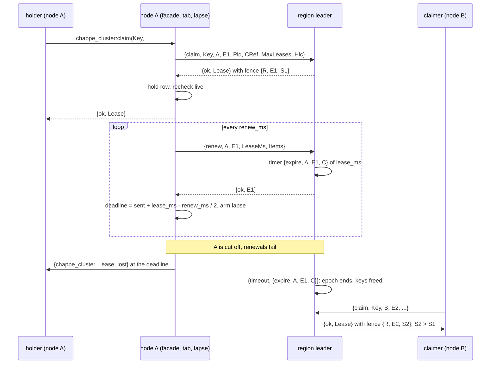

# Design overview

This page explains how chappe_cluster is built: the processes on each node,
the Ra machine the region shares, how a lease lives and ends, and the
singletons, watches, directory and clock on top of it. Read it before you
change the machine, the lease timings or anything a holder relies on. The
reasons behind each rule are in
[decision 0010](../../../../docs/decisions/0010-cluster-ownership.md).

## Supervision

```
chappe_cluster_sup (rest_for_one, owns the chappe_cluster_tab table)
|-- chappe_cluster_pg            pg scope `chappe_cluster' (watchers, running singletons)
|-- chappe_cluster_hlc           the node's hybrid logical clock (hlc)
|-- chappe_cluster_watch         the KV watch hub
|-- chappe_cluster_lapse         the lapse timer
|-- chappe_cluster_node          the agent: Ra system and member, renewals
`-- chappe_cluster_singleton_sup one contender per singleton name
```

The order is the dependency order: with `rest_for_one`, what depends on a
process restarts with it. The watch hub starts before the member that feeds
it, and the lapse timer before the agent, so an agent crash leaves the
timer armed.

`chappe_cluster_sup` creates `chappe_cluster_tab` in its own `init/1`, so
the table belongs to the supervisor, not to a child. It holds the node's
liveness (`{live, Epoch, Deadline, Gen}`), the region's members and leader
as last seen, one row per lease held through this node, and the releases
queued for the next renewal. A crash of the agent or the lapse timer loses
no holder. The table is public: `chappe_cluster:claim/2` writes the holder
row from the caller's process, so no message queue stands between a grant
and its registration. Updates of the `live` row are compare-and-swap, so a
renewal and a lapse that race keep each other's effect.

## The machine

`chappe_cluster_machine` is the region's Ra machine. Its state holds:

- `nodes`: each live node's epoch, `lease_ms`, renew count, and the
  incarnation and request ref that took the epoch;
- `incs`: each node's latest incarnation number;
- `leases`: key to holder (node, pid, epoch, seq, claim ref, HLC), with
  `by_pid` and `counts` beside it;
- `kv`: key to `{Version, Value, HLC}`, with an ordered index for prefix
  listings;
- the region-wide counters (`last_epoch`, `seq`, `kv_seq`) and the latest
  HLC it handed out.

Commands:

| Command | Effect |
|---|---|
| `{incarnate, Node}` | the node's next incarnation number; an app start asks for one first |
| `{renew, Node, Epoch, LeaseMs, Items}` | keeps the current epoch and counts the renew; any other epoch is `{error, stale_epoch}` |
| `{renew, Node, {new, Inc, Replace, Ref}, LeaseMs, Items}` | a new epoch for the latest incarnation, ending the one it names; the same request applied twice renews the epoch it took |
| `{timeout, {expire, Node, Epoch, Count}}` | ends the epoch and frees its keys, only if epoch and count are still current |
| `{claim, Key, Node, Epoch, Pid, CRef, MaxLeases, Hlc}` | grants a free key to a live epoch; an owned key is `{error, {owned, Owner}}`, even for the same holder |
| `{release, Key, Seq, Hlc}` | frees the key if Seq is still its lease |
| `{put, ...}`, `{cas, ...}`, `{delete, Key, Hlc}`, `{delete, Key, Version, Hlc}` | KV writes with versions |
| `{down, Pid, Reason}`, `{nodeup, Node}` | a holder died: its leases go; `noconnection` keeps them and watches the node |

The `Items` of a renew are what the node gave up without a quorum (a
release, or a claim whose caller timed out); the machine drops only the
lease each one names.

The no-clock rule: the machine never reads a time, neither its own nor the
`system_time` Ra puts in a command's metadata. It applies results, so
replay and snapshots are deterministic. Expiry comes from the leader: each
renew it applies cancels the node's timer and starts `{expire, Node, Epoch,
Count}` of `lease_ms`. Ra runs these timers on the leader only, on its
monotonic clock, and appends a fired one to the log as `{timeout, Name}`. A
timer that lands behind a newer renew names an old count and ends nothing.
A new leader starts a timer for every live node in `state_enter/2`, and
monitors every holder again.

KV limits: `max_keys` is checked in the machine (a new key past it is
`{error, max_keys}`); `max_value_bytes` is checked in the caller before the
write is sent (`{error, too_large}`). A snapshot is taken every 4096
applied entries.

Writes go through `chappe_cluster_ra:command/2`: the last known leader
first, each member only what is left of one deadline, and
`{error, no_quorum}` past it. Reads (`owner/1`, `get/1`, `keys/1,2`,
`leases/0`) query the local replica, or the leader when this node runs no
member; `owner/2` and `get/2` with `consistent` go through the leader.

## Leases

A lease belongs to its node's epoch. The agent (`chappe_cluster_node`)
renews one liveness record every `renew_ms`, in a monitored helper with
one budget of `renew_ms`, so one renewal keeps every lease of the node.
A claim needs the node live at its current epoch: one the leader already
ended returns `{error, no_quorum}` to the caller.

The fence is `{Region, NodeEpoch, Seq}` (`chappe_cluster:fence/1`). Seq
comes from a region-wide counter bumped on every grant, so it grows
strictly per key. Compare fences by Seq: the epoch of a takeover can be
lower than the previous holder's.

The holder's deadline is on its own node's monotonic clock. A renewal sent
at T and answered keeps the node live until T + `lease_ms - renew_ms / 2`;
the agent writes that deadline to the table and arms
`chappe_cluster_lapse`. The lapse timer does nothing else, so a full
mailbox elsewhere never delays it; it also rereads the deadline from the
table every `renew_ms / 4`. When the deadline passes it marks the node not
live and tells every holder.

`{chappe_cluster, Lease, lost}` means: stop acting on this key now. A
holder gets it when:

- its node's deadline passes without a renewal;
- a renewal comes back `stale_epoch`, or into a new epoch;
- the region ends its node's epoch and tells the agent which keys went
  (`chappe_cluster_taken`; this message may be lost, and nothing depends
  on it);
- the lapse timer starts (it cannot know the deadline) or the app stops.

Each lost lease is queued as a release for the next renewal, so the region
frees the key as soon as the node reaches it again. Before each side
effect, a holder checks `chappe_cluster:valid/1`, which reads the table:
its row at this seq, the node live at the lease's epoch, the holder alive.



The holder gives up first: `chappe_cluster_config:timing_ok/3` checks at
start that `(lease_ms - renew_ms / 2) * (1 + d) < lease_ms * (1 - d)` under
the `max_drift` bound ([configuration](../configuration.md#the-timing-check)).

## Singletons

`chappe_cluster:singleton/2` adds a `chappe_cluster_singleton` contender
under `chappe_cluster_singleton_sup`, one per name. Every `renew_ms` until
it wins, the contender claims `{chappe_cluster_singleton, Name}` for
itself. Once it holds the lease it starts the child under a supervisor of
its own (`chappe_cluster_singleton_sup:start_child_sup/1`, linked to the
contender, the child `temporary`), and joins the child to the pg group
`{chappe_cluster_singleton, Name}`, which `whereis_singleton/1` reads.

- On `lost` the child is killed, with no shutdown: the node gives its
  leases up `renew_ms / 2` before another node may run the child.
- When the child stops, the contender shuts it down within what is left
  of the lease, gives the lease back and contends again.
- The child checks `chappe_cluster:singleton_valid/1` before each side
  effect and carries `chappe_cluster:singleton_fence/1`. Both read the
  table, so they answer while the contender is busy, and stop a child that
  wakes up from a pause after its lease went.

## Watchers

`chappe_cluster_watch` is a hub on each node. The machine sends it
`{chappe_cluster_kv, Op, Key, Value, Hlc}` for each KV change, in log
order, and the hub hands it to every local process in a pg group
`{chappe_cluster_watch, Prefix}` whose prefix matches the key. The hub
keeps no state: a hub restart loses no watch, and a watcher's death drops
its watches. A watcher whose mailbox holds `max_watch_mailbox` messages
gets `overflow` once and leaves every group. Delivery is at least once: a
member that replays its log may hand an event again.

## The directory seam

`chappe_cluster_directory` is a behaviour with two callbacks,
`publish/3` and `resolve/1`: where a key lives, as its home region and
some info. The `directory` key picks the backend. This release ships
`chappe_cluster_directory_local`, which keeps the entries in the region's
KV under `chappe_cluster/directory/`, so only this region sees them, and
`chappe_cluster:home/1` returns this node's region. A cross-region backend
implements the same callbacks with no change to callers. The directory
tells a region where a resource lives; it never decides who owns it.
Ownership stays with the region's leases, because the planned cross-region
backend is AP (decision 0010).

## HLC

`chappe_cluster_hlc` is the node's hybrid logical clock (hlc), started
with the `wall_clock` and `hlc_max_offset_ms` keys.
`chappe_cluster:now/0` returns it, ticked. Claims, releases and KV writes
carry the writer's stamp; the machine merges it with the latest stamp it
handed out, puts the result in the lease, the `leases()` rows, the watch
events and the reply, and the caller moves its clock to it. So whatever
the region applies after an event carries a later stamp, whichever wall
clock runs ahead. Use it to order events in logs; no lease or expiry
depends on it.

## Where it lives

- Code: `apps/chappe_cluster/src/`: `chappe_cluster` (API),
  `chappe_cluster_machine`, `chappe_cluster_node`, `chappe_cluster_tab`,
  `chappe_cluster_lapse`, `chappe_cluster_ra`, `chappe_cluster_watch`,
  `chappe_cluster_singleton`, `chappe_cluster_singleton_sup`,
  `chappe_cluster_directory`, `chappe_cluster_directory_local`,
  `chappe_cluster_config`, `chappe_cluster_sup`
- Tests: `chappe_cluster_machine_tests` (the machine applied directly,
  with PropEr properties), `chappe_cluster_SUITE` (one node),
  `chappe_cluster_peer_SUITE` (three to five `peer` nodes: takeover,
  quorum loss, leader change, wall clock jumps, singletons)
- Lab: `make interop-cluster` (`apps/chappe_cluster/test/e2e.sh`): nodes in
  docker under seeded faults, then `chappe_cluster_lab_checker` over their
  logs; the lab code is in `test/lab`, its own tests are
  `chappe_cluster_lab_checker_tests` and `chappe_cluster_lab_schedule_tests`
  ([the lab](../../interop/README.md))
- Settings: [configuration](../configuration.md); guide:
  [run a cluster](../guides/cluster.md)
