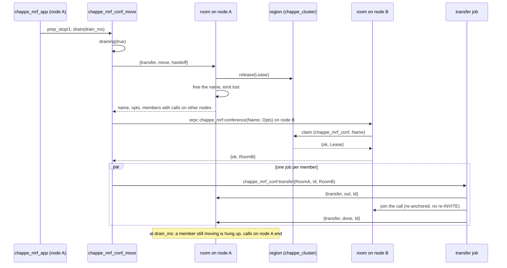

# Design overview

This page explains how chappe_mrf is built: who controls the media and who
carries it, how a FreeSWITCH channel is found and attached, how
conferences work on two backends, and what happens when something fails.
Read it before you change endpoint or conference code, or add a backend.

## Scope: controller and processors

chappe_mrf is a media resource function controller (MRFC) in the style of
drachtio-fsmrf. It holds no media. The media processors (MRFP) are:

- **FreeSWITCH**, through chappe_esl: playback, digit collection,
  recording, audio forks, mod_conference rooms;
- **rtpengine**, through `chappe_sip_media`: anchoring, transcoding,
  prompts played on a caller's leg;
- **chappe_mix**, through `chappe_sip_media`: native conference rooms.

chappe_mrf is an orchestration app: it depends on chappe_sip and chappe_esl
and reaches rtpengine and chappe_mix only through `chappe_sip_media`. The
leaf apps never depend on it.

## Processes

```
chappe_mrf_sup (one_for_one)
|-- chappe_mrf_registry   one gen_server, writes the correlation ETS table
|-- chappe_mrf_ep_sup     simple_one_for_one, temporary
|   `-- chappe_mrf_endpoint   one gen_statem per FreeSWITCH channel
`-- chappe_mrf_conf_sup   simple_one_for_one, temporary
    `-- chappe_mrf_conf       one gen_server per conference
```

Endpoints and conferences are not restarted: their owner hears they are
gone and decides. The outbound ESL listener is a chappe_esl listener
(`chappe_esl:start_listener/3`) with `chappe_mrf_esl` as handler; it runs
under chappe_esl's supervisor.

| Module | Role |
|---|---|
| `chappe_mrf` | Public API: setup, `connect_caller/3`, `create_endpoint/1`, `bridge/2,3`, endpoint commands, `conference/2`. Also holds the loopback middleware and node candidate selection. |
| `chappe_mrf_endpoint` | One channel under control: waits for its socket, answers, relays events to the owner. |
| `chappe_mrf_esl` | The `chappe_esl_handler` for outbound sockets: finds the endpoint by correlation id. |
| `chappe_mrf_registry` | Who waits for what: `{call, Id}`, `{loop, Token}`, `{conf, Name}`. |
| `chappe_mrf_conf` | Public conference API and the conference process. |
| `chappe_mrf_conf_backend` | The conference backend behaviour and the room API backends call. |
| `chappe_mrf_conf_native`, `chappe_mrf_conf_fs` | The two backends: chappe_mix behind rtpengine, mod_conference. |
| `chappe_mrf_conf_native_ep` | The media of an endpoint joining a native room: the room's media sessions and the helper that runs the steps, reporting to the room. |
| `chappe_mrf_conf_fs_join` | The fs backend's join, in the caller: endpoint, bridge, PIN. |
| `chappe_mrf_conf_cluster` | A cluster room: the start in the caller and the lease decisions in the room. |
| `chappe_mrf_conf_move` | Moving a cluster room's members to the room that owns its name next. |
| `chappe_mrf_conf_transfer` | Moving a member from one conference to another (`chappe_mrf_conf:transfer/3`). |
| `chappe_mrf_conf_refer` | REFER to and from a conference (RFC 4579): the checks, the policy, the answer. |
| `chappe_mrf_conf_refer_dial` | The parties a REFER brings in (native endpoint or fs bgdial), their progress and the nested REFER of `method=REFER`. |
| `chappe_mrf_conf_refer_member` | A member's side of REFER: its REFER to the focus, its own transfer in a room without focus, a call whose Replaces names it (the `replaces_policy`), and the call options that let the room take a member's REFERs. |
| `chappe_mrf_conf_refer_op` | The REFERs a room carries out, keyed by origin, method and target, so a repeated one dials nobody again. |
| `chappe_mrf_conf_focus` | A room as an RFC 4575 conference focus. |
| `chappe_mrf_store` | FreeSWITCH recordings adopted into the recording store (chappe_audio). |
| `chappe_mrf_app`, `chappe_mrf_sup` | Boot (chappe_cluster, the ESL listener) and the root supervisor. |
| `chappe_mrf_lib` | Small shared helpers (ids, `api` reply checks). |

## Endpoint lifecycle

An endpoint is one FreeSWITCH channel you drive from Erlang.

1. **Waiting.** `connect_caller/3` or `create_endpoint/1` starts a
   `chappe_mrf_endpoint` with a fresh correlation id and registers it as
   `{call, Id}`. Then an INVITE goes to a FreeSWITCH node: a B2BUA leg
   anchored in rtpengine (`connect_caller/3`) or a plain UAC dialog with an
   inactive SDP (`create_endpoint/1`).
2. **Attach.** The node's dialplan runs `socket Host:Port async full`, which
   opens an outbound event socket to chappe_mrf. `chappe_mrf_esl` reads the
   correlation id from the channel data, looks up `{call, Id}` and calls
   `chappe_mrf_endpoint:attach/3`. The endpoint starts a `chappe_esl_call`
   on the connection, removes its registry entry and subscribes to the
   node's up and down notices.
3. **Ready.** The endpoint answers the channel and enters `ready`. The
   caller of `await/2` (inside `connect_caller/3`) gets the channel uuid.
   Commands (`play/2`, `play_collect/2`, `record/3`, ...) run in the
   caller's process on the `chappe_esl_call`, so a long playback blocks the
   caller, not the endpoint: DTMF keeps flowing to the owner meanwhile.
4. **Gone.** On hangup the owner gets `{chappe_mrf, Ep, {hangup, Cause}}`
   and the endpoint lingers 30 s (so a late `node_down` still reaches the
   owner), then stops.

`attach_timeout` (10 s) bounds step 2. When it runs out, the B2BUA leg is
hung up and the endpoint destroyed.

An endpoint made by `create_endpoint/1` owns its INVITE dialog until
`bridge/2` hands it to a call (`chappe_mrf_endpoint:handed/1`). The caller
then sees no re-INVITE: `chappe_sip_b2b:replace_b/3` swaps the B leg.

## Correlation: X-Chappe-Call

The INVITE to FreeSWITCH carries `X-Chappe-Call: <id>`. FreeSWITCH exposes
it on the channel as `variable_sip_h_X-Chappe-Call`, which the outbound
socket's channel data includes. That is the only link between the SIP leg
and the ESL connection. A channel with no id, or an id nobody waits for, is
hung up with `UNALLOCATED_NUMBER` (see `refuse/1` in `chappe_mrf_esl`).

With several candidate nodes, `chappe_mrf_endpoint` finds which one the
INVITE landed on by matching `variable_sip_req_host` and `_port` against
the candidates' SIP URIs.

## Node choice and failover

`connect_caller/3` and `create_endpoint/1` build a candidate list:

- `targets => [{Node, SipUri}]`: used as given;
- `node => Name`: that node only, no failover;
- otherwise `chappe_esl:node_select/1` (with `select` options) picks the
  first, and every other up node follows in turn.

For `connect_caller/3`, the list becomes the B2BUA's serial target list, so
a 408, a 503 or a transport error moves to the next node.
`create_endpoint/1` tries the candidates one INVITE at a time.

## The registry

`chappe_mrf_registry` keeps a public ETS table with `read_concurrency`.
Readers (`lookup/1`, `select/1`) read it directly; only the gen_server
writes it, serializing the writes and monitoring each process that put a
key, so an entry goes with its process. `put/2` refuses a key that names
another live process (`{error, exists}`), which is how two
`conference/2` calls with one name end on the same process.

`chappe_mrf_sup` creates the table in its `init/1`, so the table is the
supervisor's and outlives the registry. A registry that restarts monitors
every process already in the table; one that died meanwhile sends its
`'DOWN'` at once and loses its entries. A room keeps its name across the
restart, and an endpoint, a loopback join or a member's dialog is still
found. `put/2` and `delete/1` wait up to a second for a registry that is
being restarted, and a write the old registry took but never answered is
made again by the new one: a `put/2` of a key its own process holds
already answers `ok`, and `delete/1` removes only its caller's own entry,
so one made again never takes a name another room claimed meanwhile.

## Native conferences and the loopback middleware

A native room is a chappe_mix room behind rtpengine. The conference process
owns the room (`persist => true`, so it stays up between callers) and every
member's media session.

To bring an anchored call in without a re-INVITE towards the caller:

1. The conference registers a token as `{loop, Token}` and runs
   `chappe_sip_b2b:replace_b(B2b, LoopUri, ...)`, where `LoopUri` is this
   node's own SIP address with user `mrf-mix-<Token>`
   (`chappe_mrf:loop_target/1`).
2. The INVITE comes back to this node. `chappe_mrf:start/1` installed an
   INVITE middleware (`chappe_mrf:install/0`) that recognises the
   `mrf-mix-` user, finds the conference and calls
   `chappe_mrf_conf:loop_invite/4`. Other INVITEs go on to your handler.
3. The conference joins the mixer with rtpengine's offer as the SDP
   (`chappe_sip_media:conference/3` with `talk_events` and
   `talk_tag => Token`), answers the loopback INVITE with the mixer's
   answer, and owns the resulting dialog.
4. Once both the `replace_b` result and the dialog are in, the member is
   added and the receivers get `{joined, Member, Info}`.

rtpengine stays in front of the mixer, so it transcodes and terminates
SRTP for the caller. Prompts to a native room play on each caller's
rtpengine leg (`chappe_sip_media:play/2`).

An endpoint of `create_endpoint/1` joins the other way: the mixer offers,
rtpengine carries the offer to the endpoint's node in a re-INVITE of the
endpoint's dialog, and the node's answer comes back through rtpengine.

A join stays in the room's `pending` map until the member is in, and
nothing it waits on runs in the room process, so the room answers its
other requests meanwhile. The room watches the process that drives it:
the helper that runs `replace_b/3`, the INVITE's request worker of a
caller joined from its INVITE, or the helper of an endpoint's media
steps. The join fails when its loopback INVITE fails, when that process
dies before it reports, or after `join_timeout`. A failed join answers its
joiner at once and gives back its mixer leg, its loopback token and
dialog, and its place in `admission/1`; the BYEs and the rtpengine
delete run in a process of their own.

An endpoint's join (`chappe_mrf_conf_native_ep`) has the room make its
two media sessions, so the room owns them, and a helper run the steps:
the endpoint's info, the mixer's offer, rtpengine's offer, the re-INVITE,
rtpengine's answer, the mixer's answer and the endpoint's watch. The
helper reports `{ep_join, Id, Step}`: the re-INVITE going out, the node
taking it, and the result; the room applies them, adding the member on
success. A failure stops the rtpengine session, leaves the mixer leg and
answers an error, and the room goes on. Once the node answered the
re-INVITE, or may have (the helper died, or the deadline came, with it
out), a failure also ends the endpoint's dialog: its channel would send
to the session that went.

The middleware only runs when chappe_sip runs a request through its chain,
so your app needs an INVITE handler (`chappe_sip:invite/1`).

## FreeSWITCH conferences

A `fs` room is a mod_conference room on one node. A call joining is first
bridged into a new endpoint on that node; the endpoint runs the
`conference` application (`chappe_esl_call:conference/3`). The member id
comes from the `conference::maintenance` events the endpoint relays to the
conference process (`add-member`, `del-member`, `start-talking`,
`stop-talking`). Mute, deaf, kick, lock and play are
`conference <name> ...` api commands. A `pin` option has the member enter
a PIN with `play_collect/2` before joining.

## The backend behaviour

A room (`chappe_mrf_conf`) is one process; its backend is the module that
carries the media. `chappe_mrf_conf:start/2`'s `backend` option names it:
`native`, `fs`, or any module that implements `chappe_mrf_conf_backend`.

Callbacks that run in the caller of `chappe_mrf_conf` (they may block, and
talk to the room with `chappe_mrf_conf:call/3`):

| Callback | Required | Called for |
|---|---|---|
| `join/4` | yes | a call or an endpoint joins; the room checks its lease, lock and member limit, then hands the request to `admit/3` |
| `transfer_check/2`, `transfer_in/3` | no | a member moves between rooms |

Callbacks that run in the room process on its state and return it:

| Callback | Required | Called for |
|---|---|---|
| `init/2`, `info/1` | yes | the backend's first state, the keys it adds to `info/1` |
| `admit/3` | yes | a join the room took |
| `set_flag/5`, `hangup/3`, `left/2`, `play/3`, `portable/0` | yes | mute and deaf, a member hung up or gone, prompts, whether members can move across nodes |
| `handle_call/3`, `handle_cast/2`, `handle_info/2` | no | `{backend, Req}`, `{backend, Msg}`, and messages the room does not know, with every `'DOWN'` but the owner's and the event receivers' |
| `lock/2` | no | the room is locked or unlocked (without it the room only keeps the flag) |
| `relate/4`, `record/3`, `stop_record/1` | no | who hears whom, room recordings |
| `handover/1`, `dial/4`, `terminate/1` | no | a transfer out, a REFER dial in the room, the room's end |

A feature whose optional callback the backend leaves out is answered
`{error, {unsupported, Backend}}`. The room reads which optional callbacks
its backend has once, when it starts.

The room API a backend calls, exported by `chappe_mrf_conf_backend`:
`bstate/1,2` (the backend's own state), `name/1`, `members/1`,
`member_by/3`, `member/3`, `put_member/3`, `joined/3`, `public/2`,
`emit/2`, `publish/1`, `talking/3`, `gone/2,3`, `drop_member/3` and
`close_if_empty/1`.

To write a backend, follow
[add a conference backend](https://github.com/benoitc/chappe/blob/main/docs/contributing/add-mrf-conference-backend.md).

## Rooms in a cluster

With `cluster => chappe_cluster`, a room name has one owner in the region:
the lease `{chappe_mrf_conf, Name}`
(`chappe_mrf_conf_cluster:lease_key/1`). `chappe_mrf_app:start/2` starts
chappe_cluster before the supervisor, so it stops after chappe_mrf and the
rooms can still hand their leases off in `prep_stop/1`
([decision 0014](https://github.com/benoitc/chappe/blob/main/docs/decisions/0014-optional-siblings.md)).
The guide shows the setup:
[run rooms on a cluster](../guides/conference.md#run-rooms-on-a-cluster).

### The claim in the caller and the waiting room

`chappe_mrf_conf:start/2` hands a cluster room to
`chappe_mrf_conf_cluster:start/2`, which runs in the caller:

1. If the local replica names an owner on another node this node reaches,
   the caller uses that room, with no write to the region. It asks the room
   for `info`: a room that runs and has not lost its name is returned; one
   that lost it or is gone is tried again after 300 ms.
2. Otherwise it starts the room's process waiting (`wait => true`): no
   name, no backend, its pid given to no one. It claims the lease for that
   pid, waiting at most `claim_timeout`, so no other room's start waits
   behind it.
3. It hands the lease over with `{activate, Lease}`.

While it waits, the room takes only `{activate, Lease}`: other calls
are kept, each with
its caller's timeout, and run in order once it is active (a call whose
caller gave up is dropped). The waiting room stops when its starter dies
or after `start_timeout`.

The claim's answers:

| Claim | What `start/2` does |
|---|---|
| `{ok, Lease}` | activates the room and returns it |
| `{error, {owned, Owner}}` | stops the waiting room and uses the owner's room if this node reaches it, else `{error, {owner_unreachable, Node}}` |
| `{error, no_quorum}` | stops the waiting room and returns the room the local replica names when it is reachable and not on this node, else `{error, no_quorum}`: it never opens a second room |

The whole start has one deadline, `start_timeout`.

### Activation

On `{activate, Lease}` the room asks `chappe_mrf_conf_cluster:activation/2`
with two facts, whether the node drains and whether
`chappe_cluster:valid(Lease)` holds:

- draining: it releases the lease and stops with `{error, draining}`, and
  the start goes on elsewhere;
- valid: it registers its name, checks draining again (a drain that began
  in between would never hand this room off), sets its backend up and runs
  the calls it kept;
- not valid: it stops with `{error, no_quorum}`.

Each join, REFER and recording start checks `chappe_cluster:valid/1`
again before its side effect (`owned/2` in `chappe_mrf_conf`).

### Draining and the prep_stop handoff

A clean stop of the node runs `chappe_mrf_app:prep_stop/1`, which calls
`chappe_mrf_conf_move:drain/1` with `drain_ms`:

1. The node is marked draining (`chappe_mrf_conf_move:draining/1`): no
   room opens here any more; a start on this node opens the room on a live
   node of the region, or returns `{error, draining}`.
2. Each room gets `{transfer, move, handoff}` from its own helper. It
   gives the lease back, frees its name and answers with its name, its
   options without this node's processes, and the members whose calls run
   on other nodes (`chappe_mrf_conf_move:handoff_of/4`).
3. For a portable room with such members, the helper opens the room of the
   same name on the first live node of the region that has or opens one
   (`chappe_mrf:conference/2` over `erpc`, at most 5 s per node), then
   moves every member at once (`chappe_mrf_conf_move:transfer_all/4`).
4. A helper still running at the deadline plus 1 s is killed. Its moves
   run on to their own end.
5. When the room ends, in a drain, a member still on its way is hung up as
   a whole call, a clean BYE; members whose calls run on this node end
   with it.



### Rehome after a lost lease

When the room gets `{chappe_cluster, Lease, lost}` for its own lease
(`chappe_mrf_conf_cluster:same_lease/2`), or a `valid/1` check fails, it
loses its name: it takes no new member (`{error, lost}`), tells its event
receivers `lost` and frees the name on this node. If it is portable and
has members, it starts a helper linked to it
(`chappe_mrf_conf_move:start_rehome/2`) that tries for `rehome_ms`, in
rounds of at most 10 s: open the room where the region lets it (this node
first, then the region's other reachable nodes) and move every movable
member there. A failed round waits up to 1 s and tries again. The room
stops once it lost its name and has no member and no join under way
(`chappe_mrf_conf_cluster:closing/3`).

### Why fs rooms do not move

`portable/0` is `true` for `chappe_mrf_conf_native` and `false` for
`chappe_mrf_conf_fs`. An fs conference is FreeSWITCH's, and each member is
a channel driven through the outbound socket the stopping node holds; the
endpoint that owns the channel hangs it up when it stops. So a handoff of
an fs room only gives the name back, and a lost fs room starts no rehome.
The next caller opens the room on a live node.

### Transfers as data

A move is `chappe_mrf_conf:transfer/3`, which runs
`chappe_mrf_conf_transfer:transfer/3` in the caller: each room only does
its part. The room's side, `chappe_mrf_conf_transfer:step/4` and
`mover_down/2`, is pure: it takes the members and the joins under way and
returns `{Reply, Members, Actions}`. The room runs the actions with
`chappe_mrf_conf_transfer:run/2`:

| Action | What the room does |
|---|---|
| `{monitor, Id, Mover}` | watches the process moving the member |
| `{gone, Id, Reason}` | removes the member (`transferred` once it arrived) |
| `{destroy, Ep}` | destroys an endpoint it owned whose mover died mid-move |

A transfer job that crashes settles by the call, not by name: the mover
asks the old room which call the member is (`handle_of`) and the new room
whether it holds it (`holds`), every 200 ms up to 100 times, and hands the
member back (`cancel`) when the new room never got it or never says.

### Timeouts

| Bound | Default | Where |
|---|---|---|
| `start_timeout` | 10000 ms | the whole cluster start, and a waiting room's life |
| `claim_timeout` | 1000 ms | one claim for a waiting room |
| `drain_ms` | 5000 ms | the whole handoff in `prep_stop/1` |
| `rehome_ms` | 30000 ms | a lost room's attempts to move its members |
| retry after a gone owner | 300 ms | `chappe_mrf_conf_cluster` |
| one node's open in a move | 5000 ms | `chappe_mrf_conf_move` |
| one rehome round | 10000 ms | `chappe_mrf_conf_move` |
| a killed handoff's grace | 1000 ms | past `drain_ms` |
| a crashed move's settle | 100 x 200 ms | `chappe_mrf_conf_move` |

The first four are chappe_mrf settings
([configuration](../configuration.md)); the others are fixed in the code.

## Failure handling

| Failure | Behaviour |
|---|---|
| No candidate node | `connect_caller/3` answers 503 and returns `{error, no_node}` |
| Outbound socket never arrives | after `attach_timeout`, the call is hung up and the endpoint destroyed |
| Unknown channel on the socket | hung up with `UNALLOCATED_NUMBER` |
| Node goes down | the endpoint's owner gets `{chappe_mrf, Ep, {node_down, Node}}` |
| The registry restarts | its table stays (the supervisor's): rooms keep their names and every entry is found; the new registry watches their processes, and one that died meanwhile loses its entries |
| Endpoint owner exits | `chappe_esl_call` stops the forks and recordings it started and kills the channel; a dialog still owned is torn down |
| Conference owner exits | the conference stops and every member is hung up (an app's endpoint leaves the room and keeps its channel) |
| `bridge/2` fails | the endpoint takes its dialog back |
| fs member never shows up | after `join_timeout` (15 s), `{error, timeout}` from the room (its joiner waits `join_timeout` and 5 s more); an endpoint made for the join is destroyed |
| A native join fails (its loopback INVITE, a media step, the endpoint's re-INVITE) | the joiner gets an error at once; the mixer leg, the rtpengine session, the loopback token and the join's place go, and the room goes on; an endpoint whose node answered the re-INVITE is hung up |
| A native join's worker dies, or the join outlasts `join_timeout` (95 s) | `{error, join_failed}` or `{error, timeout}`, with the same cleanup; an endpoint whose re-INVITE was out is hung up once that re-INVITE ends |
| A native endpoint's node is slow to answer its re-INVITE (up to 75 s) | the room answers its other requests meanwhile: control calls, other joins, REFERs |
| More than `refer_attach_max` (16) REFERs for one REFER operation | the next one gets 503, before it is accepted |
| A native join given a handle that is no call, incoming call or endpoint | `{error, badarg}` in the caller |
| A call with Replaces gets in after its hold on the member went (110 s, another caller's hold, the member's call transferred), or after another call replaced the member | the member stays; the new call is hung up (`{left, New, expired}`, `booted` in the roster) and its `join/3` returns `{error, expired}` |
| The member a call with Replaces names leaves on its own (BYE, kick) before that call gets in | the new call stays a member; nothing is hung up |
| Clean stop of a room's node (cluster) | the room gives its lease back and its members with calls on other nodes move to a room of the same name on a live node, within `drain_ms`; a move not done by then is hung up; fs rooms only give the name back |
| Room's lease lost (cluster) | the room takes no new member (`{error, lost}`), sends `lost` and frees its name; a native room moves its members to the next owner for up to `rehome_ms` |
| Owner node unreachable (cluster) | `conference/2` returns `{error, {owner_unreachable, Node}}` until the lease runs out, then opens the room on a live node |
| No quorum (cluster) | `conference/2` opens no room: it returns the reachable room the local replica names, else `{error, no_quorum}`; rooms already open keep their calls |

## Where it lives

- Code: `apps/chappe_mrf/src/`
- Tests: `chappe_mrf_SUITE` (on fakes, claims the compliance rows),
  `chappe_mrf_cluster_SUITE` (rooms on several nodes),
  `chappe_mrf_conf_backend_SUITE` (a third backend on the behaviour),
  `chappe_mrf_lib_tests`, `chappe_mrf_store_tests`, and
  `chappe_mrf_live_SUITE` (FreeSWITCH and rtpengine), `chappe_mrf_hd_live_SUITE`
  (16 kHz rooms with pjsua callers on G.722, Opus and PCMU)
- Lab: `make interop-mrf` (`apps/chappe_mrf/interop/`: rtpengine and two
  FreeSWITCH nodes); `make demo-cluster` (rooms on a cluster,
  `demo/cluster/README.md`)
