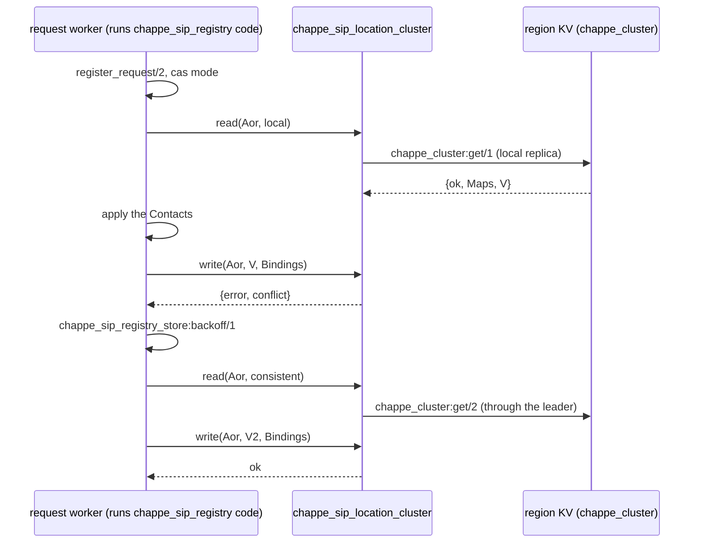
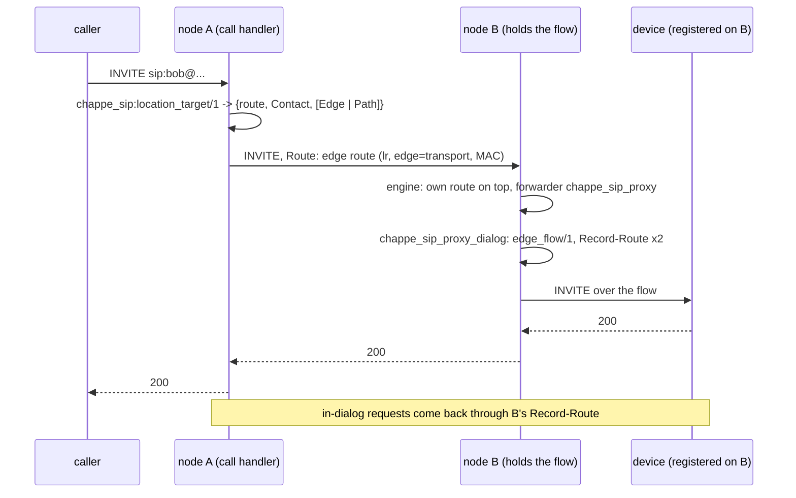

# Registrar design

The registrar is split in three: the REGISTER rules in
`chappe_sip_registry`, the bindings in a location backend behind the
`chappe_sip_location` behaviour, and the flows and edge routes in
`chappe_sip_flow` that let a call reach a device from another node. This
page shows how a REGISTER is applied, how the two backends differ, and
what happens to a call for a device registered on another node. Read it
before you change the location store, add a backend, or touch the edge
path of the proxy. To run a registrar, read the
[registrar guide](../guides/registrar.md).

## Binding logic

`chappe_sip_registrar:handler/1` (behind `chappe_sip:registrar/1`)
authenticates the REGISTER, then calls
`chappe_sip_registry:register_request/2`, which applies RFC 3261 10.3
steps 1 and 5 to 8, RFC 3327 5.3 and RFC 5626 6.

| Module | Owns |
|---|---|
| `chappe_sip_registry` | The rules: the AOR (canonical To URI), Path (420 without `Supported: path`), `Contact: *`, the per-binding CSeq check, the bounds, the gen_server for serialized writes and the periodic tick. |
| `chappe_sip_registry_contact` | The Contacts of one REGISTER: each expiry, the `registrar_min_expires` floor (423), 19.1.4 URI equality, a binding per `+sip.instance` and reg-id tied to its flow. |
| `chappe_sip_registry_store` | What every write and read does whatever the backend: `modify/3`, the CAS retry and its backoff, the flow index, `live/2`, `to_map/2`, `by_q/1`, `send_flow/1`. |
| `chappe_sip_registry_keeper` | Owns the ETS table, so the bindings outlive a crash of the registry. |

A binding is the `#binding{}` record of `src/conn/chappe_sip_location.hrl`.
Besides the RFC 3261 fields it keeps the flow, the Path, the instance and
reg-id, the flow the REGISTER came on (`received`), its transport, and on
every write the node that took it (`node`) and that node's boot (`boot`,
`chappe_sip_flow:boot/0`).

The bounds, checked in `commit/3` before the write:

| Bound | Default | Past it |
|---|---|---|
| `registrar_max_bindings_per_aor` | 10 | 403 |
| `registrar_max_aors` (ets backend) | 100000 | `full`, 503 |
| chappe_cluster `max_keys` (cluster backend) | 100000 | `full`, 503 |
| chappe_cluster `max_value_bytes` (cluster backend) | 65536 | `too_large`, 403 |

`full` is a plain 503. Only `no_quorum` gets `Retry-After`
(`registrar_retry_after`, 5 s).

## The location behaviour

`chappe_sip_location:backend/0` reads the `cluster` setting:
`chappe_sip_location_ets` by default, `chappe_sip_location_cluster` with
`cluster => chappe_cluster`. The registry never names a backend
([decision 0015](../../../../docs/decisions/0015-location-behaviour.md)).

| Callback | What it does |
|---|---|
| `read/2` | The AOR's bindings and version; `local` (this node's view) or `consistent` (on a cluster, the leader's). |
| `write/3` | Replace the AOR's bindings if still at the version read: `ok`, or `conflict`, `no_quorum`, `too_large`, `full`. |
| `aors/0`, `clear/0` | Every AOR; drop everything. |
| `write_mode/0` | `serialized` or `cas`. |
| `start/0`, `stop/0` | Started and stopped with the registry. |
| `periodic/2` | Run every `registrar_sweep_ms` (30000) in the registry process. |
| `held/4`, `mine/0` | The index of the AORs this node holds bindings of. |
| `view/2` | A binding as this node shows it, `[]` to leave it out. |
| `edge/1` | A new binding as it is stored, with the route other nodes reach it through. |

The two backends:

| | `chappe_sip_location_ets` | `chappe_sip_location_cluster` |
|---|---|---|
| Storage | the node's ETS table | one KV value per AOR in the region, `chappe_sip/aor/<AOR>` |
| `write_mode/0` | `serialized`: through the registry process, version always 0 | `cas`: from the request worker, a compare-and-swap on the version read |
| Reads | the table | the local replica (answers without a quorum) |
| `periodic/2` | the sweep, in the registry | a resync of this node's index against the region, in a helper process |
| Sweep | the registry | the `chappe_sip_registry_sweep` singleton |
| `view/2`, `edge/1` | as stored | edge route ahead of the path, flow left out (below) |

### Serialized writes

`register_request/2` calls the registry with a deadline 5 s ahead. A
request whose deadline is less than 100 ms away, or whose caller is gone,
is refused with 500 unapplied, so no binding lands after its caller has
answered.

### CAS writes and the read-retry

In cas mode no registry process is involved: the request worker runs the
read, the write and the retries. Only serialized mode goes through the
`chappe_sip_registry` gen_server.

- The first try reads the local replica. A try that lost the
  compare-and-swap reads through the leader, since the replica that misled
  it may still be behind (`chappe_sip_registry_lag_tests`, with the
  `chappe_sip_location_lagging` backend).
- At most 5 tries, with 2, 5, 10 and 20 ms between them; the last
  conflict is 500.
- A write waits for the quorum at most `registrar_cluster_timeout_ms`
  (1000). Without one, the registrar answers 503 with `Retry-After`.
- A value is the bindings as maps, so a node of a later release with more
  fields still reads it; a field the writer did not know takes its
  default.

### The sweep and the index

- On a cluster the sweep is one `chappe_cluster` singleton per region,
  `chappe_sip_registry_sweep`, registered by
  `chappe_sip_location_cluster:start/0`. Every `registrar_sweep_ms` it
  deletes the expired bindings of every AOR, checking
  `chappe_cluster:singleton_valid/1` before each write. Each delete is a
  compare-and-swap, so a sweep racing a REGISTER never removes the new
  binding.
- On shutdown `chappe_sip_app:prep_stop/1` calls
  `chappe_sip_registry:leave_cluster/0`, which stops the singleton here so
  another node takes it.
- Each node indexes the AORs it holds bindings of, and the flows they use
  (`chappe_sip_registry_store`). A dropped flow
  (`chappe_sip_registry:remove_flow/1`) purges its bindings without
  reading the whole region; a purge the region could not take is tried
  again every second. The resync reads each indexed AOR through the
  leader, pausing 20 ms every 50 reads, and stops at the first read that
  finds no quorum.
- Reads already leave out expired bindings (`live/2`), and the bindings of
  a connection or WS flow of an earlier boot of this node.

## Flows and edge routes

A flow is where a request came in and can be sent back
(`chappe_sip_flow`): a WS connection (an integer), a TCP or TLS connection
of the native stack (`{conn, Id}`), or a UDP source (`{udp, Ip, Port}`,
with the local address when there are several).

- A connection or WS id names something only within one boot of one
  node. The token of such a flow carries the node and boot
  (`chappe_sip_flow:here/0`) in its MAC, so a route to it is refused on
  another node, or after a restart, even with a shared
  `flow_token_secret`.
- A UDP token stays valid across restarts when every node has the same
  `flow_token_secret`.

On a cluster, `chappe_sip_location_cluster:edge/1` gives a new binding an
edge route when this node reaches it over its own flow (an RFC 5626 flow,
a WS connection, a UDP source behind a NAT): a Route that names this node
and the flow, signed (`chappe_sip_flow:edge_route/4`) and valid until the
binding expires plus 32 s. A binding behind a Path, or a contact reached
directly, has none.

`view/2` on another node shows such a binding with its edge route first in
`path` and no `flow` or `received`. When the holding node is not in
`[node() | nodes()]`, a UDP binding is shown at its address, and a TCP,
TLS or WS one is left out until the UA registers again.

### A call to a device registered on another node

- Node B's engine sees its own route on top (`chappe_sip_dispatch:is_own_route/2`,
  which checks the edge MAC through `chappe_sip_flow:valid_edge/1`) and
  hands the request to the forwarder, `chappe_sip_proxy:forward_indialog/2`.
- `chappe_sip_proxy_dialog` reads the flow (`chappe_sip_flow:edge_flow/1`)
  and, for a new INVITE, SUBSCRIBE or REFER, record-routes twice (RFC
  5658): the route the far side uses names the flow, the one the device
  uses names none.

### 430 Flow Failed

When the flow the edge route names is gone, node B answers 430 Flow Failed
(RFC 5626 5.3) and calls `chappe_sip_registry:remove_flow/1`:

- the send fails with `no_flow` or `<<"unknown flow">>` (`forward_failed/3`);
- or the answer is a 503 on a `{conn, Id}` flow that closed as the request
  left (`chappe_sip_engine:conn_closed/1`), the stack's own failure.

Any other failure (the engine or the WS transport busy, a full transaction
table) is a 500, and the binding stays.

## Failure handling

| Failure | Effect |
|---|---|
| The region has no quorum | REGISTER gets 503 with `Retry-After` after at most `registrar_cluster_timeout_ms`; lookups read the local replica, so calls to stored bindings go on |
| A new AOR past `max_keys` | 503 |
| The edge node stops | UDP bindings reached at their address; TCP, TLS and WS bindings left out until the device registers again |
| The flow at the edge node is gone | 430, the flow's bindings removed |
| The edge node restarts | its connection and WS edge routes no longer validate |
| The sweep's node stops or loses its lease | the singleton moves to another node |
| The registry process crashes | the ETS table is the keeper's, and survives |

## Where it lives

- Modules: `chappe_sip_registrar` (`src/api/`); `chappe_sip_registry`,
  `chappe_sip_registry_contact`, `chappe_sip_registry_store`,
  `chappe_sip_registry_keeper`, `chappe_sip_registry_sweep`,
  `chappe_sip_location`, `chappe_sip_location_ets`,
  `chappe_sip_location_cluster` (`src/conn/`); `chappe_sip_flow`,
  `chappe_sip_route` (`src/sip/`); `chappe_sip_proxy_dialog`
  (`src/proxy/`); `chappe_sip_qualify` (`src/peers/`).
- Tests: `chappe_sip_registrar_SUITE`; `chappe_sip_registrar_cluster_SUITE`
  (three peer nodes: calls through the edge over UDP, TCP and WS, the dead
  flow, the edge node down, the lost quorum, the sweep singleton);
  `chappe_sip_registry_lag_tests` with `chappe_sip_location_lagging`;
  `chappe_sip_flow_tests`.
- Lab: `make demo-cluster` (see `demo/cluster/README.md`).
- Decisions: [0010](../../../../docs/decisions/0010-cluster-ownership.md),
  [0015](../../../../docs/decisions/0015-location-behaviour.md).
