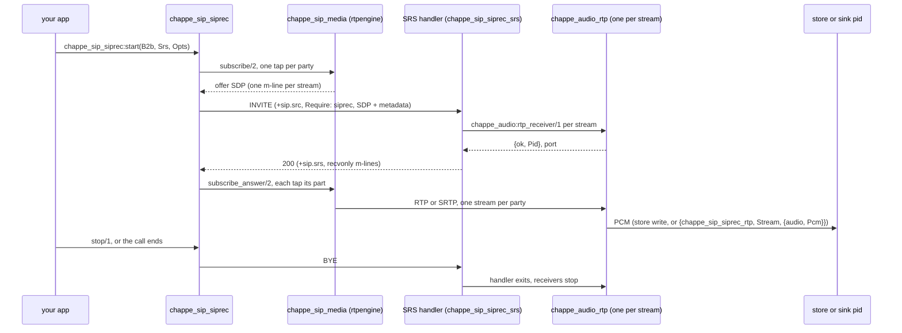

# SIPREC design

chappe_sip speaks SIPREC (RFC 7866) on both sides: a recording client (SRC)
that sends an anchored call or a chappe_mix room to a recording server, and
a recording server (SRS) that takes a recording session in a handler. This
page shows which process does what on each side, how a recording follows
its call, and where the SIP side stops and chappe_audio takes the RTP. Read
it before you change a `chappe_sip_siprec*` module or the RTP receiver. To
use either side, read the [SIPREC guide](../guides/siprec.md).

## The split

- SIP runs in chappe_sip on both sides. RTP never reaches a chappe_sip
  process: on the client it leaves rtpengine (or the chappe_mix room), on
  the server it lands in chappe_audio
  ([decision 0012](../../../../docs/decisions/0012-siprec-srs.md)).
- The two sides are independent. chappe can record to any SRS, and any SRC
  can record to chappe.

## The client side

One `chappe_sip_siprec` process per recording, a temporary child of
`chappe_sip_siprec_sup`. It is owned by the caller of `start/3` (or
`owner`), and the owner's exit ends it.

| Module | Role |
|---|---|
| `chappe_sip_siprec` | The gen_server: the RS dialog, the state (`inviting`, `active`, paused), events to the owner. |
| `chappe_sip_siprec_tap` | The media side: one rtpengine subscription per party (`chappe_sip_media:subscribe/2`), or one sendonly leg of a chappe_mix room. |
| `chappe_sip_siprec_body` | Pure functions: the multipart body (SDP offer and metadata), the SRS answer cut back per tap, the argument checks and the security check of `start/3`. |
| `chappe_sip_siprec_meta` | The RFC 7865 metadata, built and parsed. |
| `chappe_sip_siprec_peer` | What the SRS sends in the RS dialog: a snapshot request in an UPDATE, a re-INVITE, BYE; the rest refused. |

### How it starts

1. `start/3` checks its arguments in the caller (`chappe_sip_siprec_body:srs/1`,
   `valid_opts/1`) and reads the call with `chappe_sip_b2b:info/1`. A call
   with direct media is `{error, not_anchored}`.
2. The recording starts on the call's node (`erpc` to
   `chappe_sip_siprec_sup:start_child/1` when that is another node).
3. `init/1` counts the call's recordings on that node against
   `siprec_max_per_call` (default 2). Every recording of a call runs on
   the call's node, so the count is the cluster's. It then runs the
   security check (`{error, {insecure_srs, tls}}`) and joins the call
   (`chappe_sip_call:join/3`, as `siprec`).
4. `handle_continue(invite, _)` makes one participant and one stream per
   party, opens the taps, and sends the RS INVITE through
   `chappe_sip_uac:start/2`, with `contact_params => <<";+sip.src">>` and
   `Require: siprec`.
5. The answer is split per tap and handed back to rtpengine
   (`chappe_sip_media:subscribe_answer/2`, with `allow_transcoding`).

`answer_timeout` (default `siprec_answer_timeout_ms`, 10000) bounds every
INVITE and re-INVITE. Past it the recording stops with `{srs, timeout}`.

### How a recording follows its call

| What happens | What the recording does |
|---|---|
| The call's media session process exits (the call ended) | BYE to the SRS, `stopped` with `call_ended` |
| The room's mixer goes (watched with `chappe_sip_siprec_tap:watch/1`) | BYE, `stopped` with `room_ended` |
| `replace_b/3` on the call | `chappe_sip_b2b_media:event/2` sends `{chappe_sip_b2b, Ref, {replaced, Leg}}` to every recording of the call (`chappe_sip_siprec:local/1`); the new party is tapped on the same stream, and a re-INVITE carries metadata that disassociates the old party and associates the new one |
| `pause/1`, `resume/1` | the taps are removed and the streams go `a=inactive`, then the taps are opened again and the streams go `a=sendonly` |
| The owner exits | the taps are closed and the process ends; its RS dialog sends the BYE; no event (nobody to tell) |
| The recording crashes | its RS dialog sends the BYE; the call's media session removes the taps it held for the recording (`holder => self()` in the subscription); the call goes on |

A party change that arrives while a re-INVITE is pending is kept
(`recheck`) and handled after it.

### What the SRS sends

The UAC and the dialog are two senders, so the SRS's first in-dialog
request can reach the recording before the UAC reports the dialog.
`chappe_sip_siprec_peer` holds those events and replays them in order once
the dialog is known (`replay/1`). It holds at most 8; past that a request
gets 491.

### Metadata

Every metadata document is a full snapshot (`datamode` complete). The
session element carries chappe's `call_ref` in chappe's own namespace, so
a recording server finds the call in chappe's records. A document over
65536 bytes is refused unparsed, and an id, label, name or AOR over 1024
bytes is refused. The media type is `application/rs-metadata+xml` (RFC
9806); `legacy_content_type => true` sends RFC 7866's
`application/rs-metadata`, and `chappe_sip_siprec_meta:is_content_type/1`
takes both.

## The server side

`chappe_sip_siprec_srs` is a library the INVITE handler calls, not a
process. The handler process owns the receivers; when it exits they stop
and close their store recordings. So the handler calls `serve/3` and then
`run/1`, which carries the session until it ends.

### serve/3

1. `is_recording_session/1`: `+sip.src` in the Contact and `siprec` in
   Require (RFC 7866 6.2). The route must accept the tag
   (`chappe_sip:handle/3` with `option_tags => [<<"siprec">>]`). Otherwise
   `{error, not_recording_session}`, and `Res` is left for the app.
2. The multipart body is read: the SDP, and the metadata when present (it
   may follow later, RFC 7866 9.1). A body that does not parse is 488.
3. The sink is resolved: `store => default | module()` (default the
   `siprec_store` setting, `chappe_audio_store`), or `sink => pid()`. A
   store module that is not loaded is `{error, {no_store, Mod}}`, answered
   500.
4. If `chappe_audio_rtp_sup` is not running (chappe_audio is an optional
   application of chappe_sip), every stream is refused, the session logs
   `siprec_srs_chappe_audio_not_running`, and `serve/3` returns
   `{error, no_audio}` after a 488.
5. Each m-line, up to `max_streams` (default 4), gets a receiver through
   `chappe_audio:rtp_receiver/1`. The rest, and any stream it cannot take,
   are answered with port 0 (RFC 3264 6).
6. The 200 has every taken stream `a=recvonly` (`a=inactive` when the
   offer does not send, RFC 3264 6.1), its `a=label`, PCMU (0) and PCMA
   (8) only, and `+sip.srs` in the Contact.

Steps 5 and 6, stream by stream, are `chappe_sip_siprec_srs_stream`:
`offer/3` reads what a media section asks, `take/4` starts its receiver
or answers port 0, and `retake/4` answers a re-offer.

With no stream left the INVITE gets 488 and a Warning that says why:

| Warning | When | Returns |
|---|---|---|
| 302 Incompatible transport protocol | a stream was secure and none could be taken | `{error, srtp}` |
| 305 Incompatible media format | audio came, in no codec it takes, or no port was free | `{error, no_streams}` |
| 304 Media type not available | no audio came | `{error, no_streams}` |

### What each receiver gets

`chappe_sip_siprec_srs_stream` builds the receiver's options (`rtp_opts()` in
`chappe_audio`):

- `owner => self()`, the handler process;
- `remote`: the client's address for the stream, from its SDP, unless
  `rtp_source => learn` (then the first source wherever it comes from);
- `ports`: `rtp_ports`, default the `siprec_rtp_ports` setting
  (`undefined`, any port);
- `srtp`: a `chappe_audio_srtp` context from the client's `a=crypto` line,
  or `undefined`;
- `sink`: `{store, Mod, #{call_ref, source => siprec, parties, format}}`,
  where `call_ref` is the one in the metadata, else the INVITE's, and
  `parties` the AORs of the stream's senders; or `{pid, Pid}`;
- `tag => chappe_sip_siprec_rtp`, the tag a sink process matches;
- `max_queue` (default 500): a sink pid with that many messages waiting
  loses frames.

### run/1

`run/1` answers each re-INVITE, and each UPDATE with an SDP offer (in
its 200, RFC 3311 5.2), through one re-offer path, with one m-line per
offered one (RFC 3264 6):

- a stream with a receiver keeps it while the offer keeps its audio
  profile and PCMU or PCMA. A new key goes to the receiver
  (`chappe_audio_rtp:rekey/2`), a moved source re-latches it: it learns
  again from the new address on any port, as at the start, and drops a
  late packet from the old source for 1 s (`chappe_audio_rtp:remote/2`,
  RFC 3264 8.3.1), so a client that keeps sending from there is heard
  again; an old-style hold (`c=0.0.0.0`, 8.4) keeps the source,
  the answer lists the offer's G.711 formats in its order (6.1), and the
  direction follows the offer (`a=inactive` for an inactive or recvonly
  offer, `a=recvonly` for a sendonly one);
- an offer at port 0, with no PCMU or PCMA left, with SDES keys on a
  request that did not come over TLS or WSS, or an SDES stream with no
  `a=crypto` line the server takes (RFC 4568 5.1.2), stops the receiver and
  answers port 0 (RFC 3264 8.2, 8.3.2, RFC 4568 8.3); another media type
  or profile stops it and takes the stream as a new one (8.3.1, 8.3.3);
- the key rule is judged on the transport of the request that carries
  each offer, not on the INVITE's;
- a stream the offer adds, or one refused before, is taken as in the
  INVITE: a receiver, or port 0 past `max_streams`;
- an answer that changes takes a new o= version (RFC 3264 8);
- an offer with fewer m-lines than the session is refused 488, and the
  session stays as it was;
- a re-INVITE with no offer gets the current SDP, and an UPDATE with the
  metadata alone an empty 200;
- the metadata of a request is told only once it is accepted.

The notify process (`notify`, else the sink pid) gets:

- `{chappe_sip_siprec_srs, Dialog, {metadata, Doc}}` for each metadata
  update (RFC 7866 9.2);
- `{chappe_sip_siprec_srs, Dialog, {stopped, Why}}` at the end, `Why` the
  BYE request or the dialog's reason.

## SRTP

The recording server decrypts SRTP itself, in the receiver, and never
sends any ([decision 0009](../../../../docs/decisions/0009-srtp-in-erlang.md)).

- A stream offered as `RTP/SAVP` or `RTP/SAVPF` with an `a=crypto` line
  `chappe_sip_sdes:select/1` takes (AES_CM_128_HMAC_SHA1_80 or _32) is
  answered in the same profile with a key of its own
  (`chappe_sip_sdes:answer/1`).
- Any other secure stream (another suite, several keys, DTLS-SRTP's
  `UDP/TLS/RTP/SAVP`) is answered with port 0.
- Keys over a transport that is not TLS or WSS, to a Request-URI that is
  not `sips:`, are refused the same way (RFC 4568 8.3). `keys_over_tls =>
  false` lifts that.

On the client side, a call with an SRTP leg has its taps offered as
`RTP/SAVP`, keyed by rtpengine apart from the call's keys, and a call with
a TLS leg is recorded only to a `sips:` or `transport=tls` SRS (RFC 7866
12). `allow_downgrade => true` lifts both.

## Failure handling

| Failure | Effect |
|---|---|
| The SRS refuses the RS INVITE | `stopped` with `{rejected, Status}`; the call goes on |
| The SRS does not answer in `answer_timeout` | CANCEL (or BYE after a re-INVITE), `stopped` with `{srs, timeout}` |
| The recording process crashes | no event to the owner (monitor `Rec`); BYE from its dialog; taps removed by the call's media session |
| A receiver crashes | that stream stops; the store's partial file is left to its sweep; the other streams and the handler go on |
| The store crashes | the receivers run under `chappe_audio_rtp_sup`, apart from the store, and keep going ([decision 0011](../../../../docs/decisions/0011-chappe-audio-leaf.md)) |
| chappe_audio not running | every RS refused 488, `{error, no_audio}` |

## Where it lives

- Client: `chappe_sip_siprec`, `chappe_sip_siprec_sup`,
  `chappe_sip_siprec_tap`, `chappe_sip_siprec_body`,
  `chappe_sip_siprec_meta`, `chappe_sip_siprec_peer`, in `src/siprec/`.
- Server: `chappe_sip_siprec_srs` and `chappe_sip_siprec_srs_stream`
  (`src/siprec/`), `chappe_sip_sdes` and
  `chappe_sip_multipart` (`src/sip/`); the receivers in chappe_audio:
  `chappe_audio_rtp`, `chappe_audio_srtp`, `chappe_audio_pcm` (see the
  [chappe_audio design](../../../chappe_audio/docs/design/overview.md#recorded-rtp)).
- Tests: `chappe_sip_siprec_SUITE` (client against a wire peer and against
  chappe as the SRS, on `chappe_sip_test_rtpe`),
  `chappe_sip_siprec_meta_tests`, `chappe_sip_sdes_tests`;
  `chappe_audio_rtp_SUITE`, `chappe_audio_srtp_tests`;
  `chappe_sip_siprec_live_SUITE` against a real rtpengine (`make interop`).
- Compliance: the RFC 7865 and RFC 7866 rows (`R7865-*`, `R7866-*`) in the
  [compliance matrix](../compliance.md).
- Decisions: [0009](../../../../docs/decisions/0009-srtp-in-erlang.md),
  [0011](../../../../docs/decisions/0011-chappe-audio-leaf.md),
  [0012](../../../../docs/decisions/0012-siprec-srs.md).
