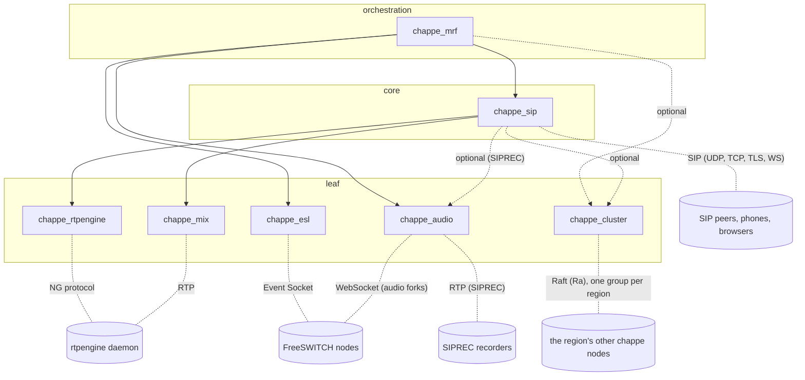
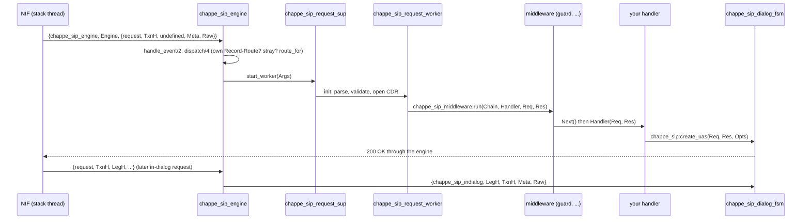
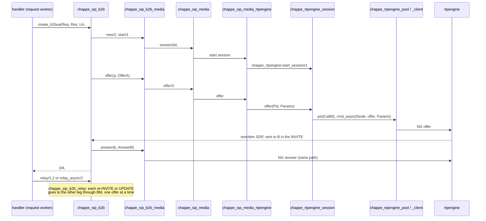
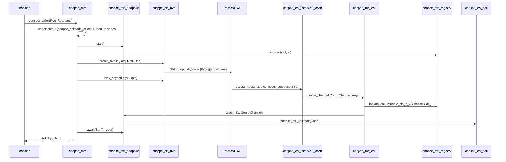
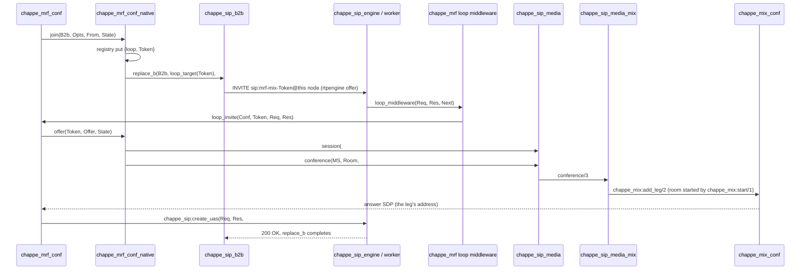
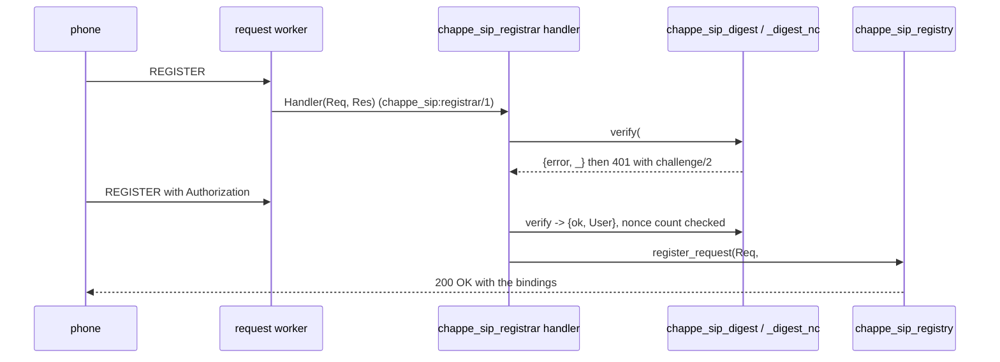
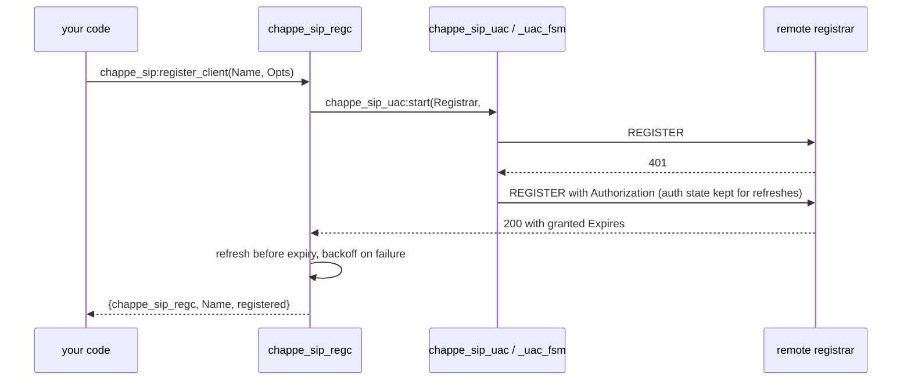

# Architecture

This page shows how the seven apps of the umbrella fit together, which
process owns what, and the path the five main flows take through the code.
Read it when you need to know where execution enters, which app to change
for a feature, or what talks to what before you open the tree. Each hop
below names a real module; the words are defined in the
[Glossary](glossary.md), and the ideas behind them in
[Concepts](concepts.md).

## Start here

- [The apps and their layers](#the-apps-and-their-layers)
- [Supervision at a glance](#supervision-at-a-glance)
- [Flows](#flows): inbound INVITE, anchored B2BUA, connect a caller to
  FreeSWITCH, native conference, registration.

## The apps and their layers



| Layer | Apps | Rule |
|---|---|---|
| Leaf | the apps listed in [0003](decisions/0003-leaf-apps.md) | One concern each. Depend on no other chappe app and on nothing SIP. |
| Core | chappe_sip | The SIP stack. Uses chappe_rtpengine and chappe_mix through its media facade (`chappe_sip_media`), started on demand. Takes SIPREC audio in through chappe_audio when it is installed. Starts chappe_cluster at boot when `cluster => chappe_cluster`. Never uses chappe_esl. |
| Orchestration | chappe_mrf | Ties SIP to media servers. Depends on chappe_sip, chappe_esl and chappe_audio, and starts chappe_cluster at boot when its `cluster` env is `chappe_cluster`. Nothing in the umbrella depends on it. |

Why the rules exist:

- Leaf apps stay SIP-free so each can be published and used alone, and so a
  SIP change cannot break them: [0003](decisions/0003-leaf-apps.md).
- RTP stays out of Erlang SIP processes, and rtpengine stays an external
  daemon: [0004](decisions/0004-rtpengine-external.md).
- The mixer exists next to FreeSWITCH conferences:
  [0005](decisions/0005-chappe-mix.md).
- Code that needs SIP and FreeSWITCH at once goes to an orchestration app,
  not into chappe_sip: [0006](decisions/0006-mrf-orchestration-app.md).
- What needs one owner in a cluster takes a lease from chappe_cluster, one
  Ra group per region: [0010](decisions/0010-cluster-ownership.md).

The dependencies are in each `apps/*/src/*.app.src`. chappe_sip lists
neither chappe_rtpengine nor chappe_mix in `applications`: they are loaded
with the release and started by `chappe_sip_media_sup` when a `media` config
names them (`apps/chappe_sip/rebar.config`, `relx`). chappe_audio is in its
`optional_applications`. chappe_cluster is in no `applications` list:
`chappe_sip_app` and `chappe_mrf_app` start it before their supervisor when
the `cluster` config names it, and refuse to boot when it is not installed.

## Supervision at a glance

```
chappe_sip_sup (one_for_one)
|-- chappe_sip_pg, chappe_sip_call, chappe_sip_hlc   pg scope, calls by call_ref, the node clock
|-- chappe_sip_registry_keeper, chappe_sip_registry   location store (survives engine restarts)
|-- chappe_sip_dialog_index, chappe_sip_digest_nc, chappe_sip_cdr, chappe_sip_hep
|-- chappe_sip_refer_sup, chappe_sip_subscriber_sup, chappe_sip_events_sup
|-- chappe_sip_peers_sup, chappe_sip_metrics_http, chappe_sip_ws_sup
|-- chappe_sip_media_sup, chappe_sip_b2b_sup
|-- chappe_sip_stack_sup (rest_for_one)
|   |-- chappe_sip_engine          the one process that talks to the NIF
|   |-- chappe_sip_request_sup     one worker per inbound out-of-dialog request
|   |-- chappe_sip_dialog_sup      one chappe_sip_dialog_fsm per dialog
|   |-- chappe_sip_uac_sup         one chappe_sip_uac_fsm per outbound transaction
|   `-- chappe_sip_proxy_sup       one Accepted-state process per proxied INVITE
|-- chappe_sip_siprec_sup          one chappe_sip_siprec per recording this node sends
`-- chappe_sip_regc_sup            one chappe_sip_regc per outbound registration

chappe_rtpengine_sup (rest_for_one)
|-- chappe_rtpengine_pool          nodes, health, call pinning
|-- chappe_rtpengine_dtmf
|-- chappe_rtpengine_client_sup    one client per node
`-- chappe_rtpengine_session_sup   one session per call

chappe_mix_sup (one_for_one)
`-- chappe_mix_conf_sup            one chappe_mix_conf per room

chappe_esl_sup (one_for_one)
|-- chappe_esl_outbound_sup        one chappe_esl_conn per outbound socket
`-- chappe_esl_nodes               when the `nodes' app env is set

chappe_audio_sup (rest_for_one)
|-- chappe_audio_rtp_sup           one chappe_audio_rtp per received RTP stream (SIPREC)
|-- pg scope chappe_audio          streams by call ref, the cluster's stores
|-- chappe_audio_registry          streams waiting for their fork, by id
|-- chappe_audio_store_srv         the recording store: config, pg, sweep
|-- chappe_audio_writer_sup        one chappe_audio_writer per recording
|-- chappe_audio_adopt_sup         one chappe_audio_adopt per file taken into the store
|-- chappe_audio_stream_sup        one chappe_audio_stream per fork
|-- chappe_audio_conn_sup          one chappe_audio_conn per handshake
|-- chappe_audio_listener_sup      one chappe_audio_listener per port
`-- chappe_audio_listener          when the `listener' app env is set

chappe_cluster_sup (rest_for_one)
|-- pg scope chappe_cluster        watchers by prefix, running singletons
|-- chappe_cluster_hlc             the node's hybrid logical clock
|-- chappe_cluster_watch           hands KV changes to local watchers
|-- chappe_cluster_lapse           gives every lease up at the deadline
|-- chappe_cluster_node            the Ra member, renewals
`-- chappe_cluster_singleton_sup   one chappe_cluster_singleton per name

chappe_mrf_sup (one_for_one)
|-- chappe_mrf_registry            correlation id and loop token lookup
|-- chappe_mrf_job_sup             cleanups that wait on a peer (BYEs, deletes)
|-- chappe_mrf_ep_sup              one chappe_mrf_endpoint per channel
`-- chappe_mrf_conf_sup            one chappe_mrf_conf per conference
```

Source: the `init/1` of each `*_sup.erl`, in child order. The app overviews
have the full trees:
[chappe_sip](../apps/chappe_sip/docs/design/overview.md),
[chappe_rtpengine](../apps/chappe_rtpengine/docs/design/overview.md),
[chappe_mix](../apps/chappe_mix/docs/design/overview.md),
[chappe_esl](../apps/chappe_esl/docs/design/overview.md),
[chappe_audio](../apps/chappe_audio/docs/design/overview.md),
[chappe_cluster](../apps/chappe_cluster/docs/design/overview.md),
[chappe_mrf](../apps/chappe_mrf/docs/design/overview.md).

## Flows

### Inbound INVITE

An INVITE reaches your handler in its own process.



Notes:

- A request on a dialog leg goes straight to its dialog fsm; one on the
  default leg is out of dialog and gets a worker (`handle_event/2` in
  `chappe_sip_engine`).
- `dispatch/4` forwards a request carrying our own Record-Route as a proxy,
  answers 481 to a stray in-dialog request, 503 above
  `max_request_workers`, and 482 to a merged request.
- A worker that exits without a final response makes the engine answer 500.
- Over WebSocket, `chappe_sip_ws_transport` sends the same events as
  `{chappe_sip_engine, ws, Event}`.

Tests: `chappe_sip_pipeline_SUITE` (fake engine), `chappe_sip_uas_SUITE`,
`chappe_sip_guard_SUITE`, `chappe_sip_ood_SUITE`.

### Anchored B2BUA

`create_b2bua/4` with `media => anchor` sends both offers through
rtpengine, and the relay loop keeps doing it for the life of the call.



Notes:

- `relay_async/2` runs the loop in a process of its own and returns
  `{ok, {Pid, Ref}}`, so the handler can drive something else.
- `replace_b/3` swaps leg B for a new callee: rtpengine is re-offered toward
  the new B, and A sees no re-INVITE (`chappe_sip_b2b_replace`).
- The rtpengine session is bound to its owner and deleted when it dies.

Tests: `chappe_sip_b2bua_SUITE`, `chappe_sip_b2b_relay_SUITE`,
`chappe_sip_media_SUITE` (fake rtpengine `chappe_sip_test_rtpe`),
`chappe_rtpengine_session_SUITE`; lab: `make interop-sbc`.

### chappe_mrf connect_caller

A caller is bridged, anchored, to a FreeSWITCH node, and the node hands the
channel back over an outbound event socket.



Notes:

- The INVITE targets all candidate nodes in turn; the call moves to the
  next on 408, 503 or a transport error.
- A channel whose id nobody waits for is hung up (`UNALLOCATED_NUMBER`).
- `chappe_mrf:bridge/2,3` then moves the caller between endpoints and SIP
  targets with `replace_b/3`.

Tests: `chappe_mrf_SUITE` (fake `chappe_mrf_fake`), `chappe_mrf_live_SUITE`;
lab: `make interop-mrf`.

### Native conference

A caller joins a chappe_mix room by a loopback INVITE: leg B of its anchored
call is replaced by an INVITE to this node, which the mixer answers.



Notes:

- rtpengine stays in front of the mixer: it transcodes and terminates SRTP,
  so the mixer only sees G.711, or L16 in a 16 kHz room (decision
  [0017](decisions/0017-chappe-mix-16khz-l16.md)).
- The room is owned by the conference process and outlives its callers.
- Mute, deaf, relations and talker events come from the mixer.

Tests: `chappe_mrf_SUITE`, `chappe_mix_SUITE`, `chappe_sip_media_SUITE`;
labs: `make interop-mrf`, `make interop-mix`.

### Registration

Inbound: the registrar handler checks the digest and writes bindings.
Outbound: one process per registration keeps a binding at a registrar.





Tests: `chappe_sip_registrar_SUITE`, `chappe_sip_digest_SUITE`,
`chappe_sip_regc_SUITE`.

## Read this next

- [Glossary](glossary.md): the words this page uses.
- [Decisions](decisions/README.md): why the boundaries are where they are.
- [Navigation](navigation.md): from a concept to its modules and tests.
- [chappe_sip design overview](../apps/chappe_sip/docs/design/overview.md)
  and [engine](../apps/chappe_sip/docs/design/engine.md).

## If you want to change...

- B2BUA behaviour: [change-b2bua](contributing/change-b2bua.md).
- A media backend: [add-media-backend](contributing/add-media-backend.md).
- The C engine: [change-c-engine](contributing/change-c-engine.md).
- A new app: [add-app](contributing/add-app.md).
